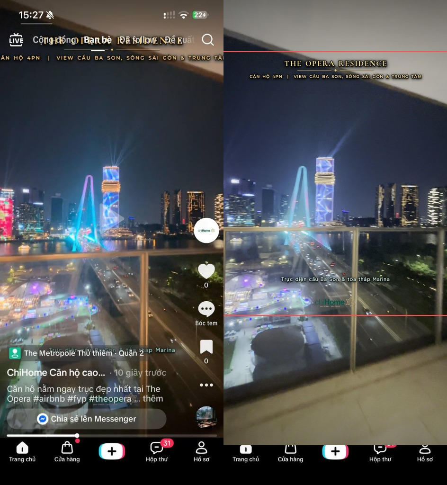
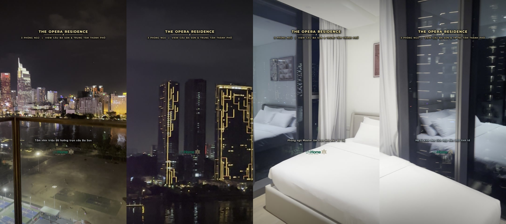
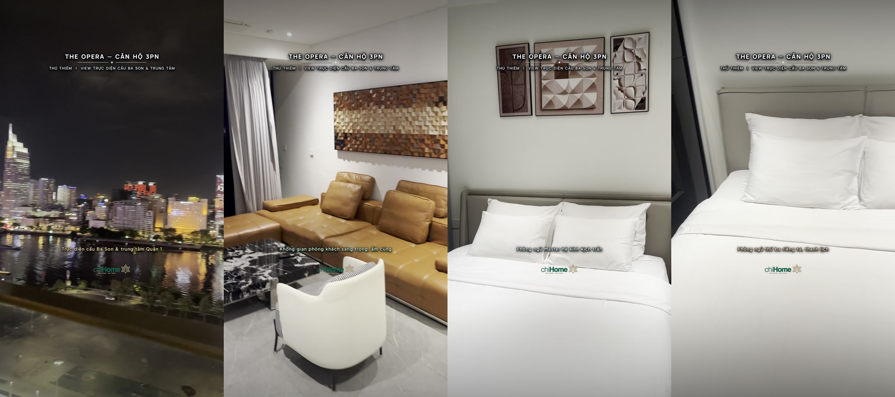
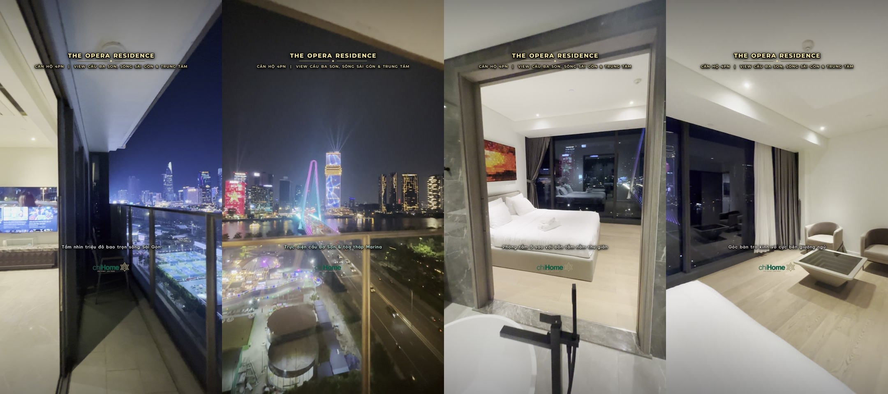
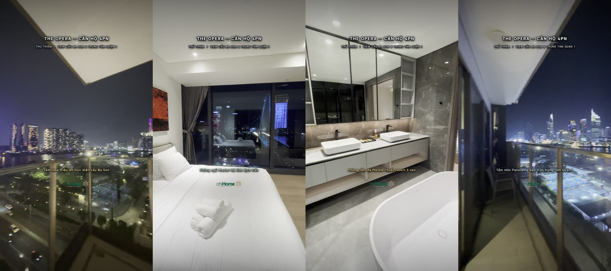

# ChiHome Luxury Video Editor (`chihome-luxury-video-editor`)

Quy trình dựng và xuất video bất động sản cao cấp chuẩn **4K 10-bit HDR (`59.94 fps`, `HEVC Main 10`, `~75–80 Mbps`)** độc quyền cho thương hiệu **ChiHome (`chihome.vn`)** tại **The Opera, The Galleria, The Crest (The Metropole Thủ Thiêm)**, lấy cảm hứng từ phong cách TikTok `@thaitairealtor` và `@ban_va_cho_thue_can_ho`.



---

## ✨ Tính năng nổi bật

1. **Giữ nguyên 100% chất lượng gốc 4K 10-bit HDR (60fps)**:
   - Giải mã và dựng trực tiếp trên không gian màu 10-bit (`yuv420p10le` / `p010le`, `BT.2020 HLG`, `59.94 fps`, Hardware Encoding `hevc_videotoolbox` ở `75 Mbps`, `-tag:v hvc1`).
   - Tự động khử cờ xoay giả (`-display_rotation:v:0 0`) để video dọc `2160x3840` hiển thị chuẩn xác trên mọi thiết bị.
2. **Chuẩn Vùng An Toàn Giao Diện TikTok iPhone (`TikTok iOS Safe Zone`)**:
   - **Tiêu đề (`top_y = 13.2%`)**: Nằm hoàn toàn bên dưới thanh điều hướng `LIVE | Cộng đồng | Bạn bè | Đã follow | Đề xuất` của TikTok.
   - **Phụ đề (`y = 62.0%`) & Logo ChiHome (`y = 66.2%`)**: Nằm hoàn toàn phía trên thẻ vị trí `📍 The Metropole Thủ thiêm` và caption bài đăng.
   - **Tự động co giãn chiều ngang (`Auto-Fit Safe Width = 72%`)**: Không bao giờ bị lẹm chữ ở 2 mép trái/phải khi màn hình iPhone `19.5:9` tự crop `~5.5%` mỗi bên.
3. **Phân biệt rõ ràng giữa TIÊU ĐỀ CỐ ĐỊNH (`Header`) và PHỤ ĐỀ CHẠY THEO CẢNH (`Subtitle`)**:
   - **Tiêu đề cố định**: Đồng bộ 1 màu sang trọng xuyên suốt video (*Champagne Gold `#FFE294`* hoặc *Diamond White `#FFFFFF`*), dùng bộ font kiến trúc tối giản **Montserrat Bold/SemiBold** hoặc **Manrope ExtraBold/SemiBold** giúp các chữ số `3PN`, `4PN` thẳng hàng 100% (*Lining Numerals*), kèm đường kẻ chỉ Kim Cương (`Luxury Ornamental Hairline`) và viền Obsidian sắc nét (`~4px` ở 4K).
   - **Phụ đề chạy theo tình huống**: Ngắn gọn 1 dòng (`6–8 chữ`), dùng font **Be Vietnam Pro Medium** hoặc **Plus Jakarta Sans SemiBold** dễ đọc tức thì, viền mảnh mềm (`~2px` ở 4K), tự động đổi màu sang trọng qua từng phân cảnh.
4. **Chuyển cảnh mượt mà theo tình huống (`Contextual xfade Transitions`)**:
   - Kết hợp `zoomin`, `smoothleft`, `smoothright`, `hblur`, `fade`, `smoothup`, `circleopen` khớp theo hướng lia máy giữa các phòng trong khi Tiêu đề và Logo ChiHome giữ cố định.

---

## 🖼️ Kết quả Preview Thực Tế (4K 10-bit HDR)

### Căn hộ The Opera 3PN



### Căn hộ The Opera 4PN



---

## 🚀 Cách sử dụng

```bash
# Chạy bộ kịch bản chuẩn cho căn The Opera 3PN
python3 scripts/edit_pipeline.py --suite 3pn --src "/duong/dan/thu_muc_clip_tho" --out "/duong/dan/thu_muc_xuat"

# Chạy bộ kịch bản chuẩn cho căn The Opera 4PN
python3 scripts/edit_pipeline.py --suite 4pn --src "/duong/dan/thu_muc_clip_tho" --out "/duong/dan/thu_muc_xuat"

# Hoặc tự động quét và dựng cho bất kỳ thư mục clip căn hộ mới nào
python3 scripts/auto_edit_folder.py --src "/duong/dan/clip_tho" --out "/duong/dan/video_da_edit" \
  --project "THE OPERA RESIDENCE" \
  --specs "3PN | VIEW CẦU BA SON & TRUNG TÂM"
```

## 📂 Cấu trúc Repository

- `SKILL.md`: Tài liệu quy trình 5 bước chuẩn của Skill `chihome-luxury-video-editor`.
- `scripts/edit_pipeline.py`: Engine dựng phim 4K 10-bit HDR, kết xuất đồ họa chữ Pillow 4K, chuyển cảnh `xfade` và đóng gói âm thanh/màu HLG.
- `scripts/auto_edit_folder.py`: Công cụ tự động phân loại clip `9:16` / `16:9`, lọc clip lỗi/trùng góc và xuất video tự động.
- `resources/fonts/`: Bộ font tối giản hỗ trợ 100% tiếng Việt & chữ số thẳng hàng (`Montserrat`, `Manrope`, `Be Vietnam Pro`, `Plus Jakarta Sans`).
- `resources/brand/`: Bộ nhận diện và logo chính thức của thương hiệu **ChiHome (`chihome.vn`)**.
- `resources/bgm/`: 4 bản nhạc nền Lounge / Ambient Luxury không bản quyền.
- `references/`: Báo cáo phân tích kênh TikTok mẫu và bảng ảnh kiểm chứng vùng an toàn TikTok.
