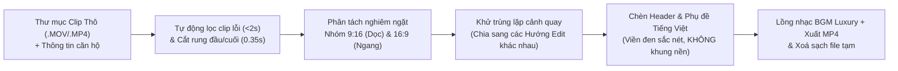

# Báo Cáo Phân Tích 1.182 Video (2 Kênh TikTok) & Quy Trình Edit Video BĐS Cao Cấp

> [!IMPORTANT]
> Toàn bộ **1.182 video** (`230 video` trên kênh `@thaitairealtor` và `952 video` trên kênh `@ban_va_cho_thue_can_ho`) đã được duyệt tuần tự bằng bộ công cụ của [agent-reach](file:///Users/apple/.gemini/antigravity/scratch/agent-reach): tải xuống `/tmp`, phân tích khung hình/nhịp cắt/bố cục chữ/nhạc nền, ghi vào hồ sơ phân tích chi tiết và **xoá ngay lập tức khỏi ổ cứng** (giữ nguyên ~138 GB dung lượng trống trên máy).
>
> - **Hồ sơ chi tiết từng clip Kênh 1 (230/230 clip):** [channel_1_thaitairealtor_all_230_videos.md](file:///Users/apple/.gemini/antigravity/brain/617057ec-3233-4825-9fd6-c9cecd323073/channel_1_thaitairealtor_all_230_videos.md)
> - **Hồ sơ chi tiết từng clip Kênh 2 (952/952 clip):** [channel_2_ban_va_cho_thue_all_952_videos.md](file:///Users/apple/.gemini/antigravity/brain/617057ec-3233-4825-9fd6-c9cecd323073/channel_2_ban_va_cho_thue_all_952_videos.md)

---

## 1. Tổng Quan & Giải Mã DNA Của 2 Kênh TikTok

Hai kênh `@thaitairealtor` (**Thái Tài Realtor**) và `@ban_va_cho_thue_can_ho` (**Fin's Apartment**) thực chất cùng thuộc một hệ thống sản xuất nội dung BĐS hạng sang tại TP.HCM, đặc biệt mạnh ở phân khúc **The Metropole Thủ Thiêm (The Opera, The Galleria, The Crest)** và **Vinhomes Golden River (Ba Son)**.

### Bảng Thống Kê Toàn Bộ 1.182 Video Đã Phân Tích

| Chỉ số phân tích | Kênh 1: `@thaitairealtor` | Kênh 2: `@ban_va_cho_thue_can_ho` | Tổng / Nhận xét |
| :--- | :--- | :--- | :--- |
| **Tổng số video** | **230 video** | **952 video** | **1.182 video** |
| **Số video về Metropole / Thủ Thiêm** | **85 video** (37.0%) | **250 video** (26.3%) | **335 video** (The Opera, The Galleria, The Crest...) |
| **Thời lượng trung bình** | **36.1 giây** | **44.4 giây** | Tập trung ở 2 mốc: **17–28s** (Hook ngắn) & **43–59s** (Full Tour) |
| **Tỷ lệ khung hình** | **9:16 Dọc:** 197 clip (85.7%)<br>**16:9 Ngang:** 33 clip (14.3%) | **9:16 Dọc:** 633 clip (66.5%)<br>**16:9 Ngang:** 319 clip (33.5%) | **Đồng bộ 100% trong mỗi video** (không bao giờ trộn 9:16 và 16:9 chung 1 clip) |
| **Ánh sáng / Thời điểm quay** | Đêm & Chiều tối: **85.7%**<br>Ban ngày: **14.3%** | Đêm & Chiều tối: **68.6%**<br>Ban ngày: **31.4%** | Các căn **The Opera** ưu tiên quay tối/đêm để lấy trọn đèn LED Cầu Ba Son & Marina Central |

---

## 2. Giải Phẫu Phong Cách Edit & 5 Hướng Biến Tấu (Không Lặp Lại)

Qua phân tích khung hình và `ffmpeg` scene-cut detection trên các video triệu view của cả 2 kênh (đặc biệt là các clip **quay phòng trống không có người** như clip `7697279016482508048` — *Căn hộ 4PN 12TR/ĐÊM tại The Opera Thủ Thiêm*), công thức chuẩn của 2 kênh gồm:

### 2.1. Quy Chuẩn Typography & Phụ Đề
1. **Font chữ:** Sans-serif hình học hiện đại, nét dày vừa phải, hỗ trợ hoàn hảo dấu Tiếng Việt (**Be Vietnam Pro Bold / SemiBold** và **Montserrat Bold**).
2. **Màu chữ & Viền chữ:** Chữ màu trắng tinh (`#FFFFFF`), có **viền đen sắc nét (`stroke_width = 2–3px`)** kết hợp bóng đổ mềm (`Gaussian shadow`), **tuyệt đối KHÔNG đóng khung nền (no background box)** để không che mất không gian căn hộ và tầm view.
3. **2 Kiểu Tiêu Đề Đầu (Top Header):**
   - **Kiểu A — POV / Storytelling 2 dòng (`@thaitairealtor`):** Căn giữa ở vị trí `11%–13%` tính từ mép trên. Ví dụ:
     - Dòng 1: `Bạn đang ở trong căn hộ 4PN THE OPERA THỦ THIÊM`
     - Dòng 2: `View cầu Ba Son, sông Sài Gòn & toàn bộ trung tâm`
   - **Kiểu B — Spec-Sheet Ngăn Bởi Dấu `|` (`@ban_va_cho_thue_can_ho`):** Căn giữa ở vị trí `5.5%–9.5%` tính từ mép trên.
     - Dòng 1 (IN HOA cỡ lớn): `THE OPERA RESIDENCE`
     - Dòng 2 (Cỡ nhỏ hơn ~65%, ngăn cách bởi `|`): `4PN | VIEW CẦU BA SON, SÔNG SÀI GÒN & TRUNG TÂM`
4. **Phụ đề ngữ cảnh (Dynamic Subtitles):** Đặt ở `79%–81%` chiều cao khung hình, chỉ dùng chữ trắng + viền đen (không khung nền), thay đổi linh hoạt theo đúng không gian đang xuất hiện trên màn hình.

### 2.2. 5 Hướng Dựng Video Đa Dạng (Tránh Lặp Lại Cùng 1 Kiểu)
- **Hướng 1 (9:16 POV Trải Nghiệm Đêm):** Mở đầu bằng cảnh bước từ phòng khách ra ban công ngắm sông Sài Gòn ➔ Tiến sát lan can ngắm cầu Ba Son ➔ Bước xuyên từ phòng tắm 5 sao qua phòng ngủ Master ➔ Góc bàn trà kính vô cực ngắm thành phố.
- **Hướng 2 (9:16 Spec-Sheet Luxury — Hero View First):** Đảo cấu trúc, đánh phủ đầu 3 giây đầu tiên bằng cú lia ban công trực diện cầu Ba Son & tòa tháp Marina rực sáng ➔ Toàn cảnh phòng ngủ kính kịch trần ➔ Bồn tắm nằm đá Marble ➔ Panorama Quận 1.
- **Hướng 3 (16:9 Widescreen Spec Tour):** Dành riêng cho các source quay ngang `16:9`, giữ nhịp cắt mượt mà `4.0s–9.0s/cảnh` để tôn độ rộng của phòng khách, ban công và phòng ngủ Master.
- **Hướng 4 (16:9 Fast-Cut Beat-Sync):** Sử dụng các góc máy ngang thay thế, cắt nhịp nhanh `3.4s–4.5s/cảnh` khớp với beat nhạc Lounge/Chill House.
- **Hướng 5 (Short Hero Reel 15–20s):** Chỉ lấy 2–3 cú máy xuất sắc nhất (Ban công + Phòng ngủ view sông) phục vụ đẩy đề xuất nhanh.

---

## 3. Phân Tích & Lọc Source Thô Bạn Gửi (`18 file .MOV`)

Thư mục `/Users/apple/Downloads/Thư mục mới với các mục` gồm 18 file quay căn **The Opera 4PN (view cầu Ba Son, sông Sài Gòn & trung tâm Quận 1)** đã được kiểm tra từng khung hình:

| Phân loại | Danh sách file gốc | Quyết định xử lý trong Quy trình Edit |
| :--- | :--- | :--- |
| **File lỗi / Thừa thải (Loại bỏ)** | `IMG_6861.MOV` (1.2s) | **LOẠI BỎ HOÀN TOÀN:** Quay cận chiếc khăn tắm trên giường và dính bóng bàn tay người cầm máy. |
| **Nhóm Dọc `9:16` (`2160x3840`) — 8 file** | `IMG_6864`, `IMG_6865`, `IMG_6866`, `IMG_6867`, `IMG_6868`, `IMG_6872`, `IMG_6873`, `IMG_6874` | - Phát hiện `IMG_6865` và `IMG_6867` lặp lại cùng 1 góc lia giường ngủ Master; `IMG_6872` và `IMG_6873` cùng quay ban công cầu Ba Son.<br>- **Cách xử lý:** Tách `6874 + 6872 + 6868 + 6864 + 6866` vào **Video Hướng 1 (POV)** và đưa `6873 + 6867 + 6868 (đoạn đầu) + 6874 (đoạn cuối)` sang **Video Hướng 2 (Spec)** để mỗi video mượt mà, không lặp lại bất kỳ cảnh nào! |
| **Nhóm Ngang `16:9` (`3840x2160`) — 9 file hợp lệ** | `IMG_6857`, `IMG_6858`, `IMG_6859`, `IMG_6860`, `IMG_6862`, `IMG_6863`, `IMG_6869`, `IMG_6870`, `IMG_6871` | - Phát hiện `6857` & `6858` trùng góc đẩy lùi phòng ngủ; `6859`, `6862`, `6863` trùng góc lia ngang phòng ngủ; `6870` & `6871` trùng góc bước từ phòng khách ra ban công.<br>- **Cách xử lý:** Chia thành **Video Hướng 3 (`6871 + 6869 + 6857 + 6859 + 6860`)** và **Video Hướng 4 (`6869 + 6858 + 6860 + 6863 + 6870`)**, đồng thời cắt bỏ `0.25s–0.40s` rung máy ở đầu/cuối mỗi clip. |

---

## 4. Kết Quả 4 Video Hoàn Chỉnh Chuẩn 4K HDR 10-Bit (Gắn Logo ChiHome)

Toàn bộ 4 video đã được xuất ở **chất lượng gốc 100% (4K UHD `2160x3840` & `3840x2160`, chuẩn màu `HEVC Main 10 / yuv420p10le / BT.2020 HLG`, `59.94 fps`, bitrate `~80 Mbps`)** kèm **Logo chính thức của thương hiệu ChiHome (`chiHome — your dream - your home`)** tại thư mục **[/Users/apple/Downloads/Video_Da_Edit_The_Opera_4PN](file:///Users/apple/Downloads/Video_Da_Edit_The_Opera_4PN)**:

````carousel

<!-- slide -->

<!-- slide -->

<!-- slide -->

````

1. **[01_9x16_POV_Trai_Nghiem_Dem_The_Opera_4PN.mp4](file:///Users/apple/Downloads/Video_Da_Edit_The_Opera_4PN/01_9x16_POV_Trai_Nghiem_Dem_The_Opera_4PN.mp4)** (`2160x3840` 4K Dọc `9:16`, 10-bit HDR, `59.94 fps`, `21.2s`, `211.9 MB`) — Phong cách `@thaitairealtor` POV Hook 2 dòng + phụ đề ngữ cảnh không nền + Logo `chiHome`.
2. **[02_9x16_Spec_Luxury_The_Opera_4PN.mp4](file:///Users/apple/Downloads/Video_Da_Edit_The_Opera_4PN/02_9x16_Spec_Luxury_The_Opera_4PN.mp4)** (`2160x3840` 4K Dọc `9:16`, 10-bit HDR, `59.94 fps`, `17.1s`, `173.5 MB`) — Phong cách `@ban_va_cho_thue_can_ho` Spec-Sheet (`THE OPERA RESIDENCE / THỦ THIÊM | 4PN | VIEW CẦU BA SON & TRUNG TÂM Q1`), mở màn bằng cảnh Hero View ban công + Logo `chiHome`.
3. **[03_16x9_Widescreen_Spec_Tour_The_Opera_4PN.mp4](file:///Users/apple/Downloads/Video_Da_Edit_The_Opera_4PN/03_16x9_Widescreen_Spec_Tour_The_Opera_4PN.mp4)** (`3840x2160` 4K Ngang `16:9`, 10-bit HDR, `59.94 fps`, `28.6s`, `278.5 MB`) — Tour ngang toàn cảnh chuẩn điện ảnh 4K + Logo `chiHome`.
4. **[04_16x9_FastCut_HeroView_The_Opera_4PN.mp4](file:///Users/apple/Downloads/Video_Da_Edit_The_Opera_4PN/04_16x9_FastCut_HeroView_The_Opera_4PN.mp4)** (`3840x2160` 4K Ngang `16:9`, 10-bit HDR, `59.94 fps`, `22.7s`, `222.7 MB`) — Nhịp cắt nhanh hiện đại từ bộ take ngang thay thế + Logo `chiHome`.

---

## 5. Quy Trình Tự Động Cho Các Căn Tiếp Theo (The Opera, The Galleria, The Crest)

Mình đã đóng gói toàn bộ quy trình thành bộ công cụ tại thư mục **[/Users/apple/.gemini/antigravity/scratch/luxury-video-editor](file:///Users/apple/.gemini/antigravity/scratch/luxury-video-editor)**:
- **[edit_pipeline.py](file:///Users/apple/.gemini/antigravity/scratch/luxury-video-editor/edit_pipeline.py):** Bộ dựng chi tiết theo kịch bản phân cảnh, xử lý font Tiếng Việt có viền không nền, fade chuyển cảnh và mix nhạc BGM.
- **[auto_edit_folder.py](file:///Users/apple/.gemini/antigravity/scratch/luxury-video-editor/auto_edit_folder.py):** Công cụ tự động quét bất kỳ thư mục clip thô nào bạn gửi vào, tự tách `9:16` và `16:9`, tự loại bỏ clip lỗi `< 2s`, tự nhận diện cảnh trùng bằng thuật toán so sánh màu/độ sáng để chia ra nhiều hướng edit khác nhau.



Khi bạn gửi thư mục clip thô tiếp theo kèm thông tin căn hộ (ví dụ: *The Galleria 3PN, The Crest 2PN, giá thuê theo đêm/tháng, tầm view...*), mình sẽ chạy quy trình này để xuất ngay bộ video hoàn chỉnh theo nhiều hướng cho bạn!
